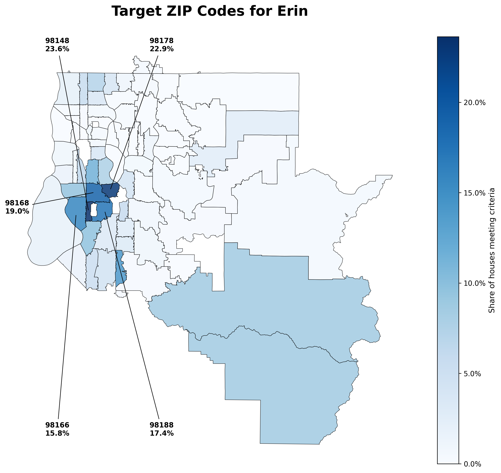

# King County Housing Market Analysis

Team project (neuefische, 2026) with Mareike Sahling (@mshlg) and Daniel Baranski (@dpbaranski); public copy of the original repository.

## Table of Contents

- [Project Overview](#project-overview)
- [Data](#data)
- [Repository Structure](#repository-structure)
- [Approach](#approach)
- [Key Findings](#key-findings)
- [Recommendation](#recommendation)
- [External Validation](#external-validation-neighbourhood-income)
- [Setup & Installation](#setup--installation)
- [How to Run](#how-to-run)
- [Limitations & Next Steps](#limitations--next-steps)
- [Contributors](#contributors)
- [License](#license)

---

## Project Overview

This project analyses the King County housing market on behalf of a (fictional) client, **Erin Robinson**; a socially responsible real estate investor. Erin wants to identify properties in lower-income or undervalued neighbourhoods where a strategic investment can generate a modest profit while contributing to neighbourhood improvement; all while keeping upfront investment costs low.

The analysis translates that brief into three testable hypotheses, explores them with descriptive statistics, correlation analysis, a non-parametric hypothesis test, and a geospatial view, and ends with a concrete, filterable shortlist of candidate properties and target ZIP codes.

**Business questions:**
- Exploration: which measurable property attributes actually relate to value (price per square foot)?
- Where in King County are there clusters of affordable, decent-quality homes that fit Erin's low-cost, socially responsible strategy?

---
## Data

- **Source:** PostgreSQL database (neuefische `eda` schema), joining `king_county_house_details` with `king_county_house_sales`.

- **Raw size:** 21,597 property sale records × 21 columns.

- **Data preparation:** Columns not relevant to the research questions were removed, retaining the 14 variables required for the exploratory analysis and recommendation.

- **Duplicate sales:** A small number of houses were sold more than once during the 2014–2015 observation period. Because the analysis focuses on **individual houses rather than sales transactions**, only the **most recent sale record** for each house is retained. This removes **177 earlier sale records**, resulting in a final analysis dataset of **21,420 unique houses**.

- **Time window:** King County home sales, 2014–2015.

- **Key fields used:** `price`, `sqft_living`, `sqft_lot`, `grade`, `condition`, `yr_built`, `yr_renovated`, `zipcode`, `lat`, `long`.

- **Data dictionary:** see [`column_names.md`](column_names.md).

- **Geospatial layer:** `data/ZIPCODE_AREA_*.geojson` provides ZIP-code boundary polygons for the map.

> ⚠️ The raw sales CSV is **not** committed to the repository (it is git-ignored). It is generated locally by running notebook 1 against the database — see [Setup & Installation](#setup--installation).

---

## Repository Structure

```
king-county-housing-analysis/
├── data/
│   ├── ZIPCODE_AREA_113_6443937376782627580.geojson   
│   └── eda_housesales.csv   (git-ignored)                           
├── images/
│   ├── price_livingarea.png
│   ├── price_sqft_by_grade.png
│   ├── price_sqft_by_condition.png
│   ├── price_sqft_renovation.png
│   └── target_zip_codes.png
├── assignment/
│   ├── assignment.md     
│   ├── workflow.md 
│   ├── Slides_eda_project.pdf     #presentation of the project 
├── 1_Fetching_the_data.ipynb      #pulls data from PostgreSQL 
├── 2_Housing_Analysis.ipynb       #cleaning, EDA, hypothesis tests, recommendation
├── column_names.md                #data dictionary
├── requirements.txt
├── LICENSE
└── README.md
```

---

## Approach

The analysis lives in **`2_Housing_Analysis.ipynb`** and is organised around three exploratory hypotheses derived from Erin's strategy. Because larger homes cost more, most of the analysis uses **price per square foot (`price_sqft`)** as a size-independent measure of value.

| Hypothesis | Statement |
|:---:|---|
| **1** | Smaller houses have a lower sale price. |
| **2a** | Houses with a lower construction grade have a lower price per square foot. |
| **2b** | Houses in poorer condition have a lower price per square foot. |
| **3** | Older, unrenovated houses have a lower price per square foot. |

**Methods used:** descriptive statistics, Spearman rank correlation, a one-sided Mann–Whitney U test (renovated vs. unrenovated homes), and choropleth-style geospatial mapping with GeoPandas.

---

## Key Findings

The results of the analyses are: 

| Hypothesis | Result | Evidence |
|:---:|:---:|---|
| **1** — size ↔ sale price | ✅ **Supported** | Spearman(`sqft_living`, `price`) = **0.64** (moderate positive). |
| **2a** — grade ↔ price/sqft | ❌ **Not supported** | Spearman(`grade`, `price_sqft`) = **0.12** (very weak). |
| **2b** — condition ↔ price/sqft | ❌ **Not supported** | Spearman(`condition`, `price_sqft`) = **0.10** (very weak). |
| **3** — old, unrenovated homes have a lower price/sqft | ❌ **Not supported** | Among the **oldest 30% of houses**, the Mann–Whitney U test found **no significant difference** in price per sqft between renovated and unrenovated homes (**p = 0.38**). |

**Takeaway:** Bigger homes sell for more (Hypothesis 1), which is expected, but raw sale price alone cannot tell us whether a home is a bargain—a cheaper house may simply be smaller. To compare properties more fairly, the analysis therefore switches to **price per square foot**.

Against this measure, construction grade and condition show only very weak relationships with price per square foot (Hypotheses 2a and 2b). Among the oldest 30% of houses, there is also no statistically significant difference in price per square foot between renovated and unrenovated properties (Hypothesis 3).

**This is still useful for Erin's search.** The results show that, beyond price per square foot, grade and condition are not strong indicators of affordability. Price per square foot therefore remains the primary measure for identifying relatively affordable properties.

---

## Recommendation and ZIP Code Search

To identify suitable areas for Erin's property search, we first define a **target property profile** based on Erin's investment criteria and our assumptions about lower-income or potentially undervalued neighborhoods.

### Step 1: Define the target property profile

Candidate properties are required to be:

- **unrenovated**,

- among the **oldest 30% of properties** based on year built,

- within the **lowest 30% of price per square foot**,

- in **condition ≥ 3**, and

- of **construction grade ≥ 7**.

The criteria serve different purposes. **Price per square foot is the primary affordability criterion.** **Age and renovation status are not included as predictors of lower prices**; instead, they reflect the assumption that the neighborhoods Erin wants to target contain a higher concentration of older and unrenovated properties.

### Step 2: Identify ZIP codes with a high concentration of matching properties

The filters are applied to **individual houses across the entire dataset**, rather than filtering properties within selected ZIP codes.

We then calculate the percentage of houses meeting the full set of criteria within each ZIP code. ZIP codes with the highest share of matching properties are identified as priority areas, where properties matching Erin's target profile are more concentrated. This allows Erin to focus her property search on the most promising areas rather than examining the entire market.

This yields **608 candidate properties (2.84% of the market)**, concentrated in a handful of ZIP codes. The five ZIP codes with the highest share of qualifying homes are:

| Rank | ZIP code | Share of candidates |
|:---:|:---:|:---:|
| 1 | **98148** | 23.6% |
| 2 | **98178** | 22.9% |
| 3 | **98168** | 19.0% |
| 4 | **98188** | 17.4% |
| 5 | **98166** | 15.8% |



These neighbourhoods offer the densest clusters of homes with **low prices per square foot**, acceptable quality, and no recorded renovation, making them the best starting point for Erin's property search.

> External validation using median household income data provides additional support for the recommended ZIP codes: four of the five target ZIP codes have median household incomes substantially below the King County median. However, one ZIP code (98166) is only moderately below the county median and should therefore be treated as a lower-confidence recommendation.

---
## External validation: neighbourhood income

Our analysis identifies target neighbourhoods purely from housing-market signals: a low price per square foot stands in for an "undervalued" or lower-income area, since the King County dataset contains no income or socioeconomic information. To assess whether the selected ZIP codes also align with Erin's focus on lower-income areas, we validated the five recommended ZIP codes against an independent source: median household income per ZIP code from the U.S. Census Bureau's American Community Survey (2024 5-year estimates).

Measured against the King County median of $124,746, four of the five targets are clearly lower-income (20% to 39% below the county figure), which provides additional support for the assumption that the selected ZIP codes align with Erin's focus on lower-income neighborhoods.

The exception is 98166, whose median household income sits only ~8% below the county median; closer to a middle-income area than a poor one. Because price per square foot is not the same as neighbourhood income, 98166 is the least certain of the five on income grounds and is best treated as a lower-confidence pick.

| ZIP | Median household income | vs. King County ($124,746) |
|:---:|:---:|:---:|
| **98148** | $87,342 | −30% |
| **98178** | $99,505 | −20% |
| **98168** | $88,083 | −29% |
| **98188** | $76,438 | −39% |
| **98166** | $114,969 | −8% |

***Note: two of these ZIP codes (98188 and 98166) differ from those shown in the presentation (98002 and 98146). The presentation reflected an earlier version of the analysis that contained a filtering error, which has since been corrected. The ZIP codes above come from the corrected notebook.***

Source: U.S. Census Bureau, American Community Survey 2024 5-year estimates (median household income, table B19013), in 2024 inflation-adjusted dollars.

---

## Setup & Installation

**Prerequisites:** Python 3.11+ and access to the course PostgreSQL database (for the data-fetching step).

**1. Clone the repository**
```bash
git clone <your-repo-url>
cd king-county-housing-analysis
```

**2. Create and activate a virtual environment**
```bash
python -m venv .venv
source .venv/bin/activate        # macOS / Linux
# .venv\Scripts\activate         # Windows (PowerShell)
```

**3. Install dependencies**
```bash
pip install --upgrade pip
pip install -r requirements.txt
```

**4. Configure database access**

Notebook 1 reads credentials from a local `.env` file (git-ignored). Create one in the project root:

```dotenv
DATABASE=your_database_name
USER_DB=your_username
PASSWORD=your_password
HOST=your_host
PORT=your_port
```

> These variables map directly to the connection in `1_Fetching_the_data.ipynb`. If you already have `data/eda_housesales.csv`, you can skip the database step and start at notebook 2.

---

## How to Run

Run the notebooks **in order**:

1. **`1_Fetching_the_data.ipynb`** — connects to PostgreSQL, runs the join query, and exports the result to `data/eda_housesales.csv`.
2. **`2_Housing_Analysis.ipynb`** — loads that CSV, cleans and prepares the data, tests the three hypotheses, and produces the recommendation and figures (saved to `images/`).

```bash
jupyter lab      # or: jupyter notebook
```

---

## Limitations & Next Steps

This is an exploratory, correlational analysis with several limitations.

- **No causal or predictive modelling is used.** The analysis identifies associations rather than causal relationships and does not account for all factors that may influence property values.

- **Thresholds influence the results.** Different cut-offs for price, age, condition, or grade could change the ZIP-code ranking.

- **The "older" criterion is assumption-driven.** Older homes are slightly more expensive per square foot in the data. The criterion is nevertheless retained because it reflects the assumed characteristics of neighborhoods Erin wants to target.

- **The neighborhood assumption is externally validated, but only after the initial analysis.** The target ZIP codes are identified using housing-market characteristics and subsequently validated against median household income data. Four of the five recommended ZIP codes have substantially lower median household incomes than King County overall, supporting the underlying assumption. However, income is only one indicator of neighborhood disadvantage.


**Possible next steps:** incorporate additional socioeconomic indicators, build a predictive price model, and run a sensitivity analysis to assess how different filter thresholds affect the shortlist.

---

## Contributors

- Mareike Sahling — [@mshlg](https://github.com/mshlg)
- Laura Gies — [@FrauGies](https://github.com/FrauGies)
- Daniel Baranski - [@dpbaranski](https://github.com/dpbaranski)

---

## License

See [`LICENSE`](LICENSE) for details.
